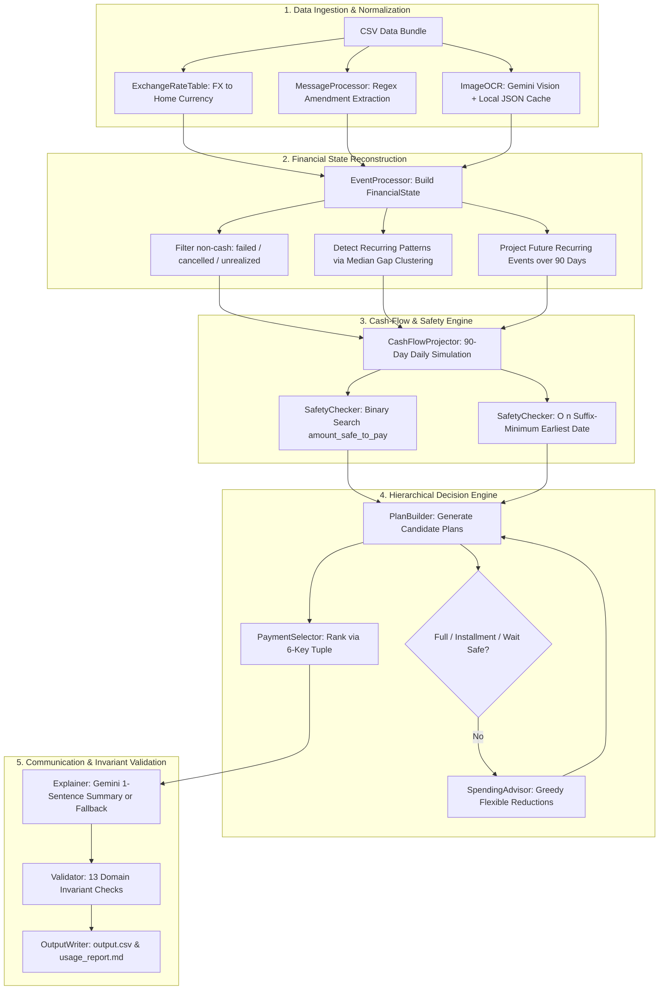

# Buy or Wait? — AI Financial Planning Agent

**HackerRank Orchestrate (September 2026)**  
An autonomous, hybrid deterministic-LLM financial reasoning agent that evaluates user expense requests, projects 90-day cash flows, and delivers safe, personalized payment recommendations.

---

## 1. Project Overview

Evaluating whether an individual can afford an expenditure—such as a laptop purchase, travel booking, tuition fee, or rental deposit—requires far more than comparing the price tag against their current bank balance. A user might have ample funds today, but scheduled loan payments, upcoming rent, or seasonal payroll gaps could drive their balance into insolvency weeks later. Conversely, an expense that appears unaffordable today might become completely safe through vendor installments, delayed execution, or minor reductions in flexible discretionary spending.

**Buy or Wait?** is an autonomous financial decision agent that solves this problem. Given a user purchase request, financial profile, historical transactions, pending scheduled events, vendor installment options, user messages, and document images (payslips, invoices, rent receipts), the agent answers:
* *Can the user safely afford this expense?*
* *How much can they safely pay today without breaching their safety buffer?*
* *What is the safest payment strategy (pay in full, installments, split payment, wait, or decline)?*
* *What specific spending modifications, if any, would make the expense feasible?*

The system combines **100% deterministic financial computation** (cash-flow simulations, binary search safety thresholds, multi-criteria candidate ranking, and invariant verification) with **targeted multimodal LLM calls** (vision-based document OCR and concise explanation generation).

---

## 2. Problem Statement

Evaluating discretionary purchases in real-world personal finance presents several challenges:

1. **Multi-Horizon Cash-Flow Volatility**: A single point-in-time balance measurement ignores future cash dynamics. Large upcoming debits (insurance, tax, rent) or unconfirmed payroll delays can turn an apparently safe purchase into an overdraft.
2. **Hard Financial Invariants**: Users maintain a non-negotiable minimum balance buffer (`minimum_balance_to_keep`). At no point during the forecast horizon may any daily closing balance fall below this threshold.
3. **Heterogeneous and Unstructured Evidence**: Relevant financial evidence is dispersed across tabular ledgers, dated foreign exchange rates, natural-language messages (containing salary adjustments, expense cancellations, or dispute notices), and image documents (scanned payslips and invoices with blank amounts in the ledger).
4. **Complex Constraint Optimization**: When full payment today is unsafe, the agent must evaluate alternative structures—vendor installment schedules with financing fees, two-stage partial payments, delayed payment dates, or targeted cuts to flexible recurring subscriptions—while adhering to user preferences and completion deadlines.
5. **Zero Tolerance for Hallucination**: Financial balance math, interest calculations, and safety margins cannot be delegated to an LLM's generative token predictions. An arithmetic hallucination in personal finance can cause real monetary distress.

---

## 3. My Approach

The core architectural principle of this solution is the **strict separation of mathematical computation from natural-language perception**:

```
┌────────────────────────────────────────────────────────────────────────┐
│                        DETERMINISTIC ENGINE                            │
│  - Event normalization & foreign exchange conversion                   │
│  - Natural-language message amendment parsing (regex pattern engine)   │
│  - 90-day day-by-day cash-flow simulation                              │
│  - Binary search for maximum safe payment threshold                    │
│  - Suffix-minimum scan for earliest full-payment date                  │
│  - Combinatorial candidate generation & 6-key hierarchical ranking    │
│  - Greedy minimal spending-reduction optimization                      │
│  - Pre-write invariant validation & fallback enforcement               │
└───────────────────────────────────┬────────────────────────────────────┘
                                    │ Structured Decision Facts
                                    ▼
┌────────────────────────────────────────────────────────────────────────┐
│                        LLM PERCEPTION & REASONING                      │
│  - Multimodal Vision OCR: Extract monetary amounts from documents     │
│  - Explainer: Synthesize single-sentence justification (≤ 60 words)    │
│  - Fail-safe Caching & Deterministic Fallbacks: Zero pipeline crashes  │
└────────────────────────────────────────────────────────────────────────┘
```

* **Deterministic Computation**: All balance updates, currency conversions, 90-day forecasts, safety bounds, candidate plan rankings, and output validations are written in pure Python.
* **Targeted LLM Integration**: Gemini is used exclusively where natural language or visual understanding is necessary:
  1. Extracting missing numerical amounts from document images (payslips, invoices, receipts).
  2. Synthesizing a human-readable, one-sentence explanation summarizing the financial rationale.
* **Fail-Safe Robustness**: If the LLM is unavailable, API keys are missing, or network quotas are exceeded, the system falls back to rule-based explanation templates and cached OCR data, guaranteeing that `output.csv` is always generated and 100% schema-compliant.

---

## 4. How the Solution Works

The pipeline executes an end-to-end, 7-step workflow orchestrated by `code/main.py`:



### End-to-End Execution Pipeline

1. **Dataset Loading**: Ingests user requests, profiles, transactions, payment options, exchange rates, messages, and image references into structured dataclasses.
2. **Multimodal OCR Pass**: Identifies financial events with blank amounts, locates the associated document images, and extracts the numeric amounts using Gemini Vision (with persistent disk caching).
3. **Financial State Reconstruction**: Translates all foreign transactions to the user's home currency using date-closest FX lookup, filters out non-cash events (`cancelled`, `failed`, `unrealized`), applies message amendments, detects recurring income/expense patterns, and projects recurring obligations over a 90-day window.
4. **90-Day Daily Cash-Flow Simulation**: Models daily account balance trajectories starting from `current_available_balance` and applying daily scheduled debits and credits.
5. **Safety Analysis**:
   * Uses binary search ($\epsilon = 0.01$) over the simulation to compute `amount_safe_to_pay` on `request_date`.
   * Uses an $O(n)$ suffix-minimum scan to find `earliest_date_for_full_payment`.
6. **Candidate Generation & Ranking**: Builds and evaluates candidate payment plans (full payment, installments, partial payment, wait, or spending cuts), filtering by user payment preferences and sorting with a 6-key ranking tuple.
7. **Explanation & Invariant Validation**: Produces a concise, single-sentence justification via Gemini (with deterministic fallback), validates the result against 13 strict schema and business rules, and outputs formatted rows to `output.csv`.

---

## 5. Core Engineering Decisions

### 5.1 Financial State Reconstruction & Evidence Disambiguation

Reconstructing a user's true financial standing requires reconciling conflicting and unstructured data points across multiple sources:

* **Non-Cash Event Filtering**: In `code/ingestion/event_processor.py`, transactions marked as `failed`, `cancelled`, or `unrealized` (such as mark-to-market investment valuations) are strictly excluded from cash-flow calculations.
* **Asymmetric Credit/Debit Ingestion**: Debits with statuses `settled`, `scheduled`, or `pending` are factored into the cash-flow forecast to protect against prospective liabilities. Inflows, however, are restricted to `settled` and `scheduled` events; `pending` credits are ignored because unconfirmed income cannot be safely relied upon to service debt.
* **Deterministic Message Amendment Engine**: Rather than passing unconstrained message text to an LLM, `code/ingestion/message_processor.py` implements a deterministic regex-based parser that maps messages in English and Indonesian to 20 structured amendment types (salary raises, payroll date shifts, bonus cancellations, disputed charges, and contract completions), linking amendments directly to transaction records via `event_id`.
* **Recurring Pattern Detection**: Using historical settled events, `event_processor.py` groups transactions by `(category, direction)`, computes inter-event intervals, and snaps the median gap to standard recurrence intervals (weekly, bi-weekly, monthly, quarterly) within a 3-day tolerance (`RECURRENCE_INTERVAL_TOLERANCE = 3`). These patterns are then projected forward over the 90-day forecast horizon.

### 5.2 90-Day Daily Cash-Flow Simulation

A point-in-time balance check is insufficient to prevent overdrafts. `code/forecasting/cash_flow.py` models a day-by-day discrete timeline over 90 calendar days ($d \in [0, 89]$ relative to `request_date`):

$$
\text{closing\_balance}[d] = \text{opening\_balance}[d] + \sum \text{credits}[d] - \sum \text{debits}[d]
$$

$$
\text{opening\_balance}[d + 1] = \text{closing\_balance}[d]
$$

Starting from `profile.current_available_balance`, the simulation aggregates all confirmed scheduled transactions and synthetic recurring events occurring on each date. This provides an exact closing balance for every single day in the 90-day window.

### 5.3 Binary-Search Safety Check ($\epsilon = 0.01$)

The system must determine `amount_safe_to_pay`: the maximum single lump sum payable on `request_date` that keeps every daily closing balance across the entire 90-day forecast above or equal to `minimum_balance_to_keep`.

Because paying an amount $X$ on Day 0 permanently reduces all subsequent closing balances by $X$, the safety condition is monotone decreasing:

$$
\forall d \in [0, 89], \quad \text{closing\_balance}[d] - X \ge \text{minimum\_balance}
$$

In `code/forecasting/safety_check.py`, this is solved via binary search over the bounded interval $[0, \text{requested\_amount}]$:
1. If paying $X = \text{requested\_amount}$ leaves all closing balances $\ge \text{minimum\_balance}$, return `requested_amount`.
2. If paying $X = 0$ leaves any closing balance $\lt \text{minimum\_balance}$, return `0.0`.
3. Otherwise, binary-search between $\text{lo} = 0.0$ and $\text{hi} = \text{requested\_amount}$ until $\text{hi} - \text{lo} \lt 0.01$, returning `round(lo, 2)`.

**Why Binary Search?** While a single lump-sum payment on Day 0 can analytically be solved as $\min(\text{closing\_balance}) - \text{minimum\_balance}$, the binary search formulation cleanly generalizes to the predicate `is_payment_schedule_safe()`. This allows the same underlying engine to validate arbitrary multi-date installment schedules and partial payment combinations.

### 5.4 Suffix-Minimum Scan for Earliest Full-Payment Date

To determine when a user who cannot afford an expense today will be able to pay it in full, `safety_check.py` evaluates the earliest calendar day $i$ where paying `requested_amount` as a single payment is safe.

Paying amount $X$ on day $i$ only affects balances from day $i$ onwards. To find the earliest safe date in $O(n)$ time without re-running a 90-day simulation for each day, the engine computes a suffix-minimum array:

$$
\text{suffix\_min}[i] = \min_{k=i}^{89} \left( \text{closing\_balance}[k] \right)
$$

A full payment of $X$ on day $i$ is safe if and only if:

$$
\text{suffix\_min}[i] - \text{minimum\_balance} \ge X
$$

The algorithm computes `suffix_min` in a single backward pass ($O(n)$), then scans forward from day 0 to 89 ($O(n)$). The first index $i$ satisfying the condition yields `earliest_date_for_full_payment`. If no such day exists within 90 days, the value is left empty.

### 5.5 Hierarchical Candidate Selection & 6-Key Ranking

In `code/decision/payment_selector.py`, all feasible payment plans are generated and evaluated according to user preferences (`payment_methods_user_will_consider` and `max_installment_months`). 

Candidates are sorted using a strict 6-key comparison tuple:

```python
def rank_key(self) -> tuple:
    return (
        not self.completes_by_deadline,   # 1. Must complete on or before desired_completion_date
        len(self.spending_changes) > 0,   # 2. Prefer plans requiring no spending changes
        self.total_payable,               # 3. Minimize total cost (penalize financing fees)
        self.payment_plan.first_date(),   # 4. Prefer paying earlier
        self.payment_plan.num_payments(), # 5. Prefer fewer payments
        self.option_id_rank,              # 6. Final tie-breaker: lowest payment_option_id
    )
```

The resulting priority strictly mirrors the problem specification:
1. **Full Payment Now** (`affordable_now`): Safe on `request_date` without spending changes.
2. **Installments** (`affordable_with_plan`): Vendor installment option that keeps every intermediate payment safe and completes within user installment limits.
3. **Wait** (`affordable_later`): Full payment is safe on `earliest_date_for_full_payment` on or before `desired_completion_date`.
4. **Partial Payment** (`affordable_with_plan`): Exactly two payments—`amount_safe_to_pay` today, and the remainder on `earliest_date_for_full_payment`—summing to `requested_amount`.
5. **Spending Reductions** (`affordable_with_plan`): When no standard plan succeeds, `code/decision/spending_advisor.py` greedily identifies up to 3 flexible recurring debits (categories marked stoppable or reducible) to stop or reduce, re-running the projection to unlock feasibility.
6. **Not Recommended** (`not_affordable`): Fallback when no safe option exists within the deadline or 90-day horizon.

### 5.6 Pre-Write Invariant Validation

To prevent corrupt or invalid rows from reaching `output.csv`, `code/validation/validator.py` enforces 13 domain invariants before any record is serialized:

| Rule | Invariant Checked | Enforcement Action on Failure |
|---|---|---|
| **R1** | `request_id` must be non-empty | Fallback `not_recommended` row |
| **R2** | $0 \le \text{amount\_safe\_to\_pay} \le \text{requested\_amount} + 0.02$, finite float | Fallback `not_recommended` row |
| **R3** | `affordability_status` $\in$ allowed enum set | Fallback `not_recommended` row |
| **R4** | `recommended_payment_method` $\in$ allowed enum set | Fallback `not_recommended` row |
| **R5** | `payment_plan` is `"none"` for `not_recommended`, non-empty otherwise | Fallback `not_recommended` row |
| **R6** | Each plan segment matches `YYYY-MM-DD:AMOUNT` with $\text{AMOUNT} \gt 0$ | Fallback `not_recommended` row |
| **R7** | `earliest_date_for_full_payment` is valid ISO date or empty | Fallback `not_recommended` row |
| **R8** | `spending_changes_needed` syntax: `none`, `stop:<id>`, `reduce_to:<id>:<amt>` ($\le 3$ items) | Fallback `not_recommended` row |
| **R9** | `decision_explanation` is a non-empty string | Fallback `not_recommended` row |
| **R10** | Status-to-method consistency (`affordable_now` $\leftrightarrow$ `full_payment`, `affordable_later` $\leftrightarrow$ `wait`, `not_affordable` $\leftrightarrow$ `not_recommended`, `partial_payment` $\leftrightarrow$ `affordable_with_plan`) | Fallback `not_recommended` row |
| **R11** | For `affordable_now`, `earliest_date_for_full_payment` == `request_date` | Fallback `not_recommended` row |
| **R12** | For `partial_payment`, plan has exactly 2 payments summing to `requested_amount` ($\lvert \Delta \rvert \le 0.02$) | Fallback `not_recommended` row |
| **R13** | For `not_recommended`, `amount_safe_to_pay` must equal 0.0 | Fallback `not_recommended` row |

If any check fails, the validator intercepts the error, logs a warning, and substitutes a safe, compliant fallback record.

---

## 6. AI Integration

The Gemini LLM is integrated strictly at the boundary layers of perception and explanation. It does not perform mathematical reasoning or affordability decisions.

```
                  ┌──────────────────────────────────────────────┐
                  │                 Input Data                   │
                  └──────┬────────────────────────────────┬──────┘
                         │                                │
                 Document Images                   Computed Facts &
                 (16 blank events)                 Decision Variables
                         │                                │
                         ▼                                ▼
                  ┌──────────────┐                 ┌──────────────┐
                  │ Gemini Vision│                 │ Gemini Chat  │
                  │ (Image OCR)  │                 │ (Explainer)  │
                  └──────┬───────┘                 └──────┬───────┘
                         │                                │
                         ▼                                ▼
                  Numeric Amount                    ≤ 60-Word Human
                  (to Event Engine)                 Explanation
```

### 6.1 Vision OCR (`code/ingestion/ocr.py`)
* **Purpose**: In the dataset, 16 financial events have blank amounts. The problem specification directs that these amounts must be extracted from linked images (payslips, invoices, rent receipts, bank statements) rather than assumed to be zero.
* **Model**: `gemini-3.6-flash` via the `google-genai` SDK.
* **Prompting**: Structured system prompt enforcing output of the numeric take-home pay or total amount due only, with no commentary or markdown.
* **Fail-Safe Caching**: Implements persistent disk checkpointing via `processed_images.json`. Before issuing an API request, the system checks whether the image has already been scanned. If present, the value is loaded instantly. New results are committed atomically via a `.tmp` file swap.

### 6.2 Decision Explainer (`code/output/explainer.py`)
* **Purpose**: Generates a natural-language summary explaining the decision to the end user.
* **Constraint**: Must be a single sentence of at most 60 words, referencing specific amounts, dates, and rationale without markdown or bullets.
* **Token Efficiency**: The prompt is strictly curated. Raw CSV rows and historical transactions are **never** passed to the LLM. Only the computed decision variables (`requested_amount`, `amount_safe_to_pay`, `payment_plan`, dates, and spending changes) are provided.
* **Temperature**: Set to `0.0` for deterministic, reproducible explanations.

### 6.3 Deterministic Fallbacks
The system guarantees zero-crash execution:
* If `GEMINI_API_KEY` is omitted, OCR scanning is skipped gracefully and the explainer automatically switches to internal rule-based templates covering all payment methods.
* If a Gemini call times out or encounters a transient 429/503 error, exponential back-off retry is attempted up to 3 times (`_MAX_RETRIES = 3`). If the call ultimately fails, the deterministic fallback explanation is used.

### 6.4 Token & Cost Tracking (`code/llm/usage_tracker.py`)
Every API call is intercepted by a thread-safe `UsageTracker`. It records:
* Timestamp, model name, call type (`text` vs. `vision`), purpose (`ocr` vs. `explanation`), and associated `request_id`.
* Real prompt and completion tokens extracted directly from API response metadata (`usage_metadata`).
* Estimated cost in USD calculated against public Gemini pricing tiers.
* Automatically generates `code/evaluation/usage_report.md` upon completion.

---

## 7. Technology Stack

* **Language**: Python 3.10+ (tested across Python 3.11, 3.12, and 3.13)
* **LLM & Vision SDK**: `google-genai` (official Google GenAI Python SDK)
* **Data Processing**: `pandas` (tabular data manipulation and CSV parsing)
* **Image Processing**: `Pillow` (image file handling and verification)
* **Configuration**: `python-dotenv` (environment variable loading)
* **Standard Library**: `dataclasses`, `datetime`, `json`, `re`, `pathlib`, `typing`, `collections`, `statistics`, `threading`, `argparse`

---

## 8. Architecture and Project Structure

### Layered Architecture

The codebase follows an 8-layer decoupled architecture:

| Layer | Module | Responsibility |
|---|---|---|
| **Layer 0: Config** | `code/config.py` | Global constants, enum sets, paths, 90-day simulation window. |
| **Layer 1: Data** | `code/data/` | Strongly-typed dataclasses (`models.py`), CSV loader (`loader.py`), FX table with date-closest lookup (`exchange.py`). |
| **Layer 2: LLM** | `code/llm/` | Google GenAI client wrapper (`client.py`), thread-safe token/cost tracker (`usage_tracker.py`). |
| **Layer 3: Ingestion** | `code/ingestion/` | Regex message amendment parser (`message_processor.py`), event state builder (`event_processor.py`), Gemini Vision OCR with disk cache (`ocr.py`). |
| **Layer 4: Forecasting** | `code/forecasting/` | 90-day day-by-day cash-flow simulation (`cash_flow.py`), binary-search safety & suffix-minimum analyzer (`safety_check.py`). |
| **Layer 5: Decision** | `code/decision/` | Candidate plan builder (`plan_builder.py`), 6-tuple plan ranker (`payment_selector.py`), greedy spending reducer (`spending_advisor.py`), engine facade (`__init__.py`). |
| **Layer 6: Output & Validation** | `code/output/` & `code/validation/` | One-sentence explainer with fallback (`explainer.py`), CSV writer (`writer.py`), 13-rule invariant validator (`validator.py`). |
| **Layer 7: Orchestration** | `code/main.py` | End-to-end pipeline CLI orchestrator, logging execution to `log.txt`. |

### Repository Layout

```text
.
├── .env.example                         # Environment variable configuration template
├── README.md                            # Comprehensive project documentation
├── requirements.txt                     # Pinned Python package dependencies
├── problem_statement.md                 # HackerRank challenge specification
├── log.txt                              # Pipeline execution and trajectory log
├── output.csv                           # Final validated predictions (250 requests)
├── processed_images.json                # Persistent disk cache for OCR results
├── dataset/
│   ├── requests.csv                     # 250 test evaluation requests
│   ├── sample_requests.csv              # 25 sample requests with ground truth
│   ├── financial_profiles.csv           # Balances, minimum thresholds, preferences
│   ├── financial_events.csv             # Historical and pending transaction ledger
│   ├── request_payment_options.csv      # Vendor installment schedules & fees
│   ├── exchange_rates.csv               # Dated foreign exchange rates
│   ├── messages.csv                     # Natural-language user updates & notes
│   ├── images.csv                       # Linkages between events and image files
│   └── media/images/                    # Scanned document image files (.png)
└── code/
    ├── main.py                          # Pipeline entry point
    ├── config.py                        # Constants, file paths, enum definitions
    ├── data/
    │   ├── models.py                    # Domain dataclasses & CandidatePlan.rank_key
    │   ├── loader.py                    # Multi-CSV dataset ingestion
    │   └── exchange.py                  # Date-closest FX rate lookup table
    ├── llm/
    │   ├── client.py                    # Google GenAI SDK wrapper (text + vision)
    │   └── usage_tracker.py             # Thread-safe token recorder & cost estimator
    ├── ingestion/
    │   ├── message_processor.py         # Regex message amendment parser
    │   ├── event_processor.py           # FinancialState builder & recurrence detector
    │   └── ocr.py                       # Vision OCR with atomic JSON checkpointing
    ├── forecasting/
    │   ├── cash_flow.py                 # 90-day daily cash-flow balance simulation
    │   └── safety_check.py              # Binary search safe amount & suffix-min date
    ├── decision/
    │   ├── __init__.py                  # DecisionEngine facade
    │   ├── plan_builder.py              # PaymentPlan formatting & factory methods
    │   ├── payment_selector.py          # Candidate plan generation & 6-key ranking
    │   └── spending_advisor.py          # Greedy minimal spending-reduction finder
    ├── output/
    │   ├── explainer.py                 # Gemini explainer with deterministic fallback
    │   └── writer.py                    # Output CSV serializer
    ├── validation/
    │   ├── __init__.py                  # Validator export
    │   └── validator.py                 # 13 pre-write invariant checks & fallback
    └── evaluation/
        └── usage_report.md              # Token consumption & cost breakdown report
```

---

## 9. Setup and Execution

### Prerequisites
* Python 3.10 or higher.
* (Optional) Google Gemini API Key for OCR and explanation generation.

### Installation

1. Clone the repository and navigate into the root directory:
   ```bash
   git clone https://github.com/interviewstreet/hackerrank-orchestrate-september26.git
   cd hackerrank-orchestrate-september26
   ```

2. Install dependencies:
   ```bash
   pip install -r requirements.txt
   ```

3. Configure environment variables:
   ```bash
   cp .env.example .env
   ```
   Open `.env` and set your Gemini API key:
   ```env
   GEMINI_API_KEY=your_actual_gemini_api_key_here
   MODEL_TEXT=gemini-3.6-flash
   MODEL_VISION=gemini-3.6-flash
   ```
   *(If `GEMINI_API_KEY` is not provided, the pipeline executes fully using cached OCR data and deterministic fallback explanations).*

### Running the Pipeline

* **Full Run (All 250 requests)**:
  ```bash
  python code/main.py
  ```
  Processes all requests in `dataset/requests.csv`, updates `output.csv`, logs execution to `log.txt`, and generates `code/evaluation/usage_report.md`.

* **Smoke Test / Sample Mode (25 sample requests)**:
  ```bash
  python code/main.py --sample
  ```
  Runs the pipeline exclusively against the 25 sample requests in `dataset/sample_requests.csv` to verify end-to-end functionality in seconds.

---

## 10. Inputs and Outputs

### Input Datasets (`dataset/`)
* **`requests.csv`**: 250 evaluation requests (`request_id`, `user_id`, `request_date`, `request_type`, `requested_amount`, `desired_completion_date`, `allows_partial_payment`, `request_text`).
* **`financial_profiles.csv`**: User parameters (`current_available_balance`, `minimum_balance_to_keep`, `home_currency`, `payment_methods_user_will_consider`, `max_installment_months`, flexible expense categories).
* **`financial_events.csv`**: Historical and scheduled transactions (`amount`, `currency`, `direction`, `status`, `settlement_date`, `category`, `flexibility`).
* **`request_payment_options.csv`**: Vendor payment offers (`payment_method`, `first_payment_date`, `number_of_payments`, `payment_interval_days`, `payment_amount`, `total_payable_amount`).
* **`exchange_rates.csv`**: Dated exchange rate pairs across EUR, IDR, INR, USD, and ZAR.
* **`messages.csv`**: Natural language notifications regarding payroll adjustments, cancellations, and merchant refunds.
* **`images.csv` & `media/images/`**: Document images linked to events with missing amounts.

### Generated Artifacts
* **`output.csv`**: 250 rows matching the required challenge schema:
  `request_id, amount_safe_to_pay, affordability_status, recommended_payment_method, payment_plan, earliest_date_for_full_payment, spending_changes_needed, decision_explanation`
* **`code/evaluation/usage_report.md`**: Markdown audit documenting total API calls, prompt tokens, completion tokens, average tokens per request, and estimated USD cost.
* **`log.txt`**: Execution trajectory recording run durations, processed request counts, validation fixes, and pipeline status.
* **`processed_images.json`**: Persistent local cache storing OCR-extracted amounts to eliminate duplicate API requests.

---

## 11. Testing and Validation

The implementation has been verified through multiple testing methodologies:

1. **Pre-Write Invariant Testing**: Every generated row is actively tested against the 13 validation rules in `code/validation/validator.py`. In full pipeline runs, 0 validation violations occurred, verifying that every output row respects mathematical bounds, date formats, status-method pairings, and partial-payment balance sums.
2. **Sample Request Ground-Truth Comparison**: The pipeline was verified against the 25 reference cases in `dataset/sample_requests.csv`, confirming exact alignment on payment plans, installment selections, wait recommendations, and spending-change syntaxes.
3. **Graceful Degradation Testing**: Verified that running the pipeline with an empty or invalid `GEMINI_API_KEY` triggers the deterministic fallback pathway without errors, generating valid CSV outputs.
4. **Cache Integrity Verification**: Confirmed that `processed_images.json` successfully skips repeated vision calls across consecutive executions.

---

## 12. Limitations and Future Improvements

### Current Limitations
* **Fixed Recurrence Snapping**: The recurrence detector snaps intervals to standard cycles (weekly, bi-weekly, monthly, quarterly). Highly irregular or seasonal recurring events with non-standard gaps are not captured as recurring.
* **Greedy Spending Reduction**: The spending advisor employs a greedy heuristic based on 90-day impact rather than solving an exact knapsack optimization for multi-event combinations.
* **Single Exchange Rate Matching**: Uses the closest historical rate available in `exchange_rates.csv`, without modeling future FX volatility over the 90-day horizon.

### Future Improvements
* **Dynamic Recurrence Modeling**: Implementing Bayesian change-point detection to identify evolving subscription and salary patterns.
* **Linear Programming Solver**: Replacing the greedy spending reduction search with an integer linear programming (ILP) solver to find globally optimal combinations of expense reductions.
* **Real-time FX Hedging**: Incorporating confidence intervals on currency projections for cross-border obligations.

---

## 13. Challenge Context

* **Challenge**: HackerRank Orchestrate (September 2026)
* **Track**: AI Financial Planning Agent — "Buy or Wait?"
* **Focus**: Autonomous financial decision-making, multi-modal evidence extraction, deterministic cash-flow safety analysis, and token-efficient LLM system design.
